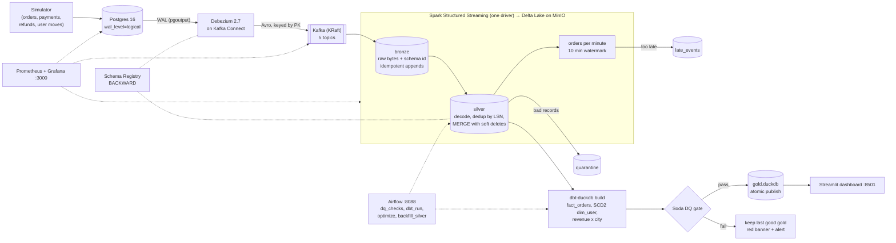

# Real-time CDC Lakehouse

> Capture every row-level change from Postgres' write-ahead log, stream it through Kafka,
> MERGE it into a Delta lakehouse, enforce quality gates, and serve live revenue and refund
> numbers that match the source exactly, even after crashes, schema changes and late events.



**Status: complete (6 of 6 weeks).** Every claim below links to a decision record in
[DECISIONS.md](DECISIONS.md) and to a measurement made with a `make` target. Week-by-week
measurements: [docs/measurements.md](docs/measurements.md). Week 6 benchmarks:
[bench/results.md](bench/results.md). A 2-minute demo plan: [docs/demo-script.md](docs/demo-script.md).

## Screenshots

| | |
|---|---|
|  |  |
| Live dashboard (revenue/min, refund rate, pipeline health) | A bad batch blocked: last good gold stays up, red banner |
|  |  |
| Grafana: Kafka lag, Spark batch time, DQ, quarantine, slot lag | Airflow DAGs (red runs = the bad-batch drill) |

*(Placeholders: the files go in [docs/img/](docs/img/README.md).)*

## Quick start

You need: Docker Engine + Compose v2, `make`, `git`, `curl`, and **about 8 GB of RAM free for
Docker** (the full stack used 7.1 GiB under load; the core pipeline alone, without Airflow and
monitoring, about 6). Tested on WSL2 Ubuntu. First run downloads images and Python/Maven
packages; with a warm Docker cache it took ‹CLONE_TIME› from `git clone` to a live dashboard.

```bash
git clone https://github.com/MuskanScripts/cdc-lakehouse.git && cd cdc-lakehouse

make up              # 1. Postgres, Kafka, Schema Registry, Connect + Debezium, MinIO; registers the connector
make stream-up       # 2. bronze + silver streaming (one Spark driver; first start downloads jars, 1-3 min)
make gold-up         # 3. dbt build loop (every 30 s, behind the DQ gate) + dashboard
make simulate RATE=50 DURATION=300   # 4. 5 minutes of orders/payments/refunds (Ctrl+C stops early)
```

Then open **http://localhost:8501**: revenue and orders per minute start moving within about
1-2 minutes (CDC → bronze → silver → gold). When the simulator has stopped:

```bash
make reconcile WAIT=300   # 5. Postgres vs silver, every row and column: expect "RECONCILE PASS: 0 difference"
make test                 # unit tests (42) in the containers
```

Optional: `make airflow-up` (http://localhost:8088, admin / admin), `make monitoring-up`
(Grafana http://localhost:3000, admin / lakehouse). Stop everything with `make down` (keeps data)
or `make clean` (deletes all volumes).

## Results

All measured on one laptop (WSL2, 9.7 GB RAM, Spark `local[4]`); how each was measured is in
[docs/measurements.md](docs/measurements.md) and [bench/results.md](bench/results.md).

| What | Result | Proven by |
|---|---|---|
| Silver = Postgres after load | **0 missing, 0 extra, 0 mismatched, 0 duplicate keys** on all 5 tables, sums equal to the cent; after every run (200/s for 3 min ×4, every drill, every benchmark) | `make reconcile` |
| Crash safety | 2 chaos runs × 10 random SIGKILLs of streaming / Connect / Kafka at 100 changes/s: **0 / 0 / 0 / 0**, 0 repeated Kafka offsets in bronze | `make chaos`, `make bronze-check` |
| Schema drift (ADD COLUMN on a live table) | in silver after **26.6 s** idle, **73.6 s** under 100/s load; no restart | `make drift` |
| Bad batch (5 negative totals injected in Postgres) | gold **blocked 121 s** after the insert, rows quarantined, alert; republished **66 s** after the source fix | `make bad-batch` / `bad-batch-fix` |
| Silver repair | 1,305 deleted silver rows restored from bronze (183,110 rows replayed) in **47.5 s** | `make silver-damage` + `make backfill` |
| End-to-end latency (Postgres commit → silver), 50/s | p50 **36-43 s**, p95 **54-64 s** (two 5-minute runs, 10 s trigger, ~10k rows each) | `make bench-trigger` |
| Silver trigger 10 s vs 30 s vs 60 s | no gain from 30 s (batches already run back to back, ~29 s each); 60 s worse (p50 48 s, p95 73 s), same 12.5 s per MERGE. **Kept 10 s** | `make bench-trigger`, ADR-034 |
| Highest rate with flat Kafka lag for 5 min | **about 400 changes/s**; 600/s and 800/s: Kafka lag grows (bronze is CPU-bound in the shared 4-core JVM). Every run reconciled to 0 afterwards | `make bench-rate` |
| OPTIMIZE / ZORDER | bronze **2,462 → 5 files**, full scan of bronze/orders **1.97 s → 0.06 s (33x)**; silver ZORDER is undone by the next MERGEs within 3 min | `make bench-optimize` |
| DQ gate cost | 14 Soda checks in 1.1-3.4 s per gold cycle | `make gold-logs` |
| Memory, whole stack under load | 7.1 of 9.7 GiB (Spark driver 3.56 of 3.9 GiB) | `make stats` |
| Tests | 42 unit tests (`make test`); CI: unit + DQ tests + `dbt parse` | [.github/workflows/ci.yml](.github/workflows/ci.yml) |
| Fresh clone → live dashboard | ‹CLONE_TIME›, following only this quick start | Week 6 fresh-clone test |

## Failure modes handled

| Hard problem | What I do | How it is proven | ADR |
|---|---|---|---|
| **Duplicates after a crash** (Spark replays a micro-batch) | silver: MERGE only if the change's Postgres LSN is newer; bronze and side tables: idempotent appends (`txnAppId` / `txnVersion`) | `make chaos` twice (10 SIGKILLs each): 0 duplicates, 0 repeated offsets; unit test for a partial multi-table commit | [012](DECISIONS.md#adr-012-soft-deletes-with-an-lsn-guard-in-the-silver-merge), [019](DECISIONS.md#adr-019-idempotent-writes-with-txnappid--txnversion), [021](DECISIONS.md#adr-021-chaos-test-sigkill-the-processing-and-transport-layers-then-reconcile) |
| **Deletes and replays** (an old insert replayed after a delete would resurrect the row) | soft deletes: a tombstone keeps `_is_deleted` and its LSN | unit tests: insert → update → delete → re-insert, older batch replayed changes nothing; the backfill replayed 183,110 bronze rows over live silver: 0 difference | [012](DECISIONS.md#adr-012-soft-deletes-with-an-lsn-guard-in-the-silver-merge) |
| **Several changes to one key in one batch, out of order** | dedup inside the batch: highest LSN, then Kafka offset | unit test; reconcile 0 after every run | [012](DECISIONS.md#adr-012-soft-deletes-with-an-lsn-guard-in-the-silver-merge) |
| **Schema drift** | bronze keeps raw bytes; silver decodes per schema id, the MERGE adds new columns; type changes go to quarantine as `schema_incompatible`; registry in BACKWARD mode | `make drift`: column in silver in 26.6 s / 73.6 s, no restart; registry verdicts checked live; unit test for the type change | [005](DECISIONS.md#adr-005-avro--schema-registry-with-backward-compatibility), [011](DECISIONS.md#adr-011-bronze-stores-raw-bytes-decoding-happens-in-silver), [018](DECISIONS.md#adr-018-schema-drift-decode-per-schema-id-let-the-merge-add-columns-quarantine-type-changes) |
| **Late events** in an event-time aggregate | 10 min watermark; anything later goes to `late_events`, never silently dropped | `make late-demo` (a 30-min-late order lands in `late_events`); measured disorder max 2.4 s | [020](DECISIONS.md#adr-020-orders-per-minute-with-a-10-minute-watermark-late-events-go-to-a-table) |
| **Poison messages vs outages** | permanently bad records (bad wire format, undecodable Avro, unknown schema, null key) → quarantine with raw bytes; a registry outage fails the batch and Spark retries | a garbage message injected live → `bad_wire_format`, 0 stream restarts; unit test for null keys | [014](DECISIONS.md#adr-014-quarantine-only-what-is-permanently-bad) |
| **The source DB filling up** (a stuck replication slot keeps WAL forever) | `max_slot_wal_keep_size=2GB`, Debezium heartbeat, slot lag in `make slot-lag` and Grafana | monitored, not drilled: I did not fill the disk on purpose | [008](DECISIONS.md#adr-008-protect-the-source-db-from-a-stuck-slot) |
| **Bad data reaching the dashboard** | Soda gate between `dbt build` and publish; correctness blocks, freshness/volume only warn; offending rows to `quarantine/dq`; alert | `make bad-batch`: blocked, quarantined, alerted, gold frozen; recovered after the fix | [029](DECISIONS.md#adr-029-who-does-what-the-30-s-gold-loop-airflow-and-the-dq-gate), [030](DECISIONS.md#adr-030-soda-core-for-data-quality-correctness-blocks-freshness-and-volume-only-warn) |
| **A half-built or failed gold build** | build into a separate file, publish by atomic rename only when tests + DQ pass; one writer at a time (flock) | a failed build keeps the last good gold with a red banner (checked headless) | [024](DECISIONS.md#adr-024-gold-with-dbt-duckdb-published-as-a-file-swap-served-by-streamlit), [027](DECISIONS.md#adr-027-the-dbt-loop-must-not-run-as-pid-1-and-a-failed-build-must-be-visible) |
| **History: a user moves city** | SCD Type 2 `dim_user` (dbt snapshot); revenue uses the city at order time | dbt test: exactly one current row per user; orders shown in their old city | [025](DECISIONS.md#adr-025-dim_user-as-a-dbt-snapshot-city-at-order-time) |
| **Silver damaged** (bug, bad deploy) | `backfill_silver` replays bronze through the stream's own code (`availableNow`) | `make silver-damage` deleted 1,305 rows → `make backfill` → reconcile 0 | [032](DECISIONS.md#adr-032-backfill_silver-replays-bronze-through-the-streams-own-code) |
| **Orchestrator crash mid-job** (orphaned Spark writers) | one writer job at a time (`exclusive.sh` stops leftovers), the "streaming paused" marker survives a crash | real incident, fixed, then `docker restart airflow` mid-OPTIMIZE: one writer, streaming resumed | [033](DECISIONS.md#adr-033-incident-airflow-restarts-left-orphaned-spark-writers-and-streaming-stopped) |

## All commands

```bash
make up                      # build + start everything, register the Debezium connector
make simulate RATE=200       # in a 2nd terminal: write orders/payments/users (Ctrl+C to stop)
make check                   # Week-1 acceptance: c/u/d events on every table's topic

make stream-up               # Week 2: start bronze + silver (one Spark driver, ~2.7 GB)
make reconcile WAIT=300      # Postgres vs silver; retries while silver catches up; exit 1 on any diff
make latency MINUTES=5       # end-to-end p50/p95/p99 over the last 5 minutes
make test                    # 42 unit tests (spark container + the DQ venv in the gold image)

# Week 3
make drift                   # ALTER TABLE orders ADD COLUMN coupon_code, time it until silver has it
make late-demo               # a 30-minute-old order must land in late_events, not in the aggregate
make late-stats MINUTES=60   # event delay + disorder percentiles (the basis for the watermark)
make chaos                   # simulator + 10 random SIGKILLs of streaming/connect/kafka, then reconcile
make bronze-check            # every Kafka offset exactly once in bronze?

# Week 4
make gold-up                 # dbt build loop (every 30 s) + dashboard → http://localhost:8501
make gold-logs               # one line per build: OK / FAILED (a failed build is not published)
make dbt-build / dbt-test    # one build / tests only, full dbt output (pauses the loop)

# Week 5
make airflow-up              # Airflow → http://localhost:8088 (admin / admin): dq_checks, dbt_run, optimize, backfill_silver
make monitoring-up           # Prometheus :9090 + Grafana → http://localhost:3000 (admin / lakehouse)
make dq                      # Soda suite once on silver (SOURCE=build: on the last gold build)
make gold-cycle              # one build -> DQ gate -> publish by hand
make bad-batch               # DRILL: 5 negative-total orders into Postgres -> gold blocked, alert, quarantine
make bad-batch-fix           # fix them at the source -> next cycle publishes again
make silver-damage N=50      # DRILL: delete every 50th order from silver (streaming paused)
make backfill TABLE=orders   # Airflow backfill_silver: repair silver from bronze (START=, END=)
make optimize-dag            # run the nightly OPTIMIZE ZORDER + VACUUM DAG now
make stats                   # free -h + docker stats for every container
make kafka-ui                # Kafka UI on :8080 (no longer started by `make up`)

# performance tooling
make bench-silver LABEL=x    # silver batch times at 50 changes/s for 3 min → bench/silver_bench.log
make table-stats             # active files + avg file size per silver table
make merge-profile           # Delta's own MERGE timings: exec / scan / rewrite, rows copied
make thread-cpu C=streaming  # per-thread CPU of a JVM container
make optimize                # stop streaming, OPTIMIZE + VACUUM 168h, start streaming (LAYER=bronze, ZORDER=1)

# Week 6 benchmarks (results in bench/results.md)
make bench-trigger           # silver trigger 10 vs 30 vs 60 s, same 50/s load (TRIGGERS="10 30 60")
make bench-rate RATES="100 200 400"   # Kafka + silver lag trend, 5 min per rate (SIM_ARGS=--fast above ~400/s)
make bench-optimize          # file counts + fixed queries before/after OPTIMIZE (bronze) and ZORDER (silver)
```

`make stream-up` is separate from `make up` because the Spark driver is the biggest memory
consumer (4 GB limit, ~3.5 GiB used once warm). Everything together (stream + gold +
orchestration + monitoring) used 7.1 GiB of WSL's 9.7 under load. Airflow and monitoring each start
on their own: `make airflow-up`, `make monitoring-up`.

### Data quality and Airflow

Every gold cycle is `dbt build` → **DQ gate** (`quality/checks.yml`, Soda, on the tables just
built) → atomic publish. The 30 s loop and Airflow's `dbt_run` run the same script and take turns
on a lock (ADR-029). Blocking checks: null/duplicate keys, `total >= 0`, `amount >= 0`, status in
the allowed set, every order has a user. Freshness (silver vs Postgres) and volume (last hour vs
trailing hours) only warn (ADR-030). A blocked cycle keeps the last good gold, turns the
dashboard banner red and Grafana's "Gold: last cycle" to BLOCKED. Airflow's `dq_checks` writes
the offending rows to `s3://lakehouse/quarantine/dq` and alerts: to Slack if
`SLACK_WEBHOOK_URL` is set (export it before `make airflow-up`), otherwise to the task log and
`/opt/airflow/logs/alerts.log`.

### The dashboard (http://localhost:8501, after `make gold-up`)

Refreshes every 10 s from the last green dbt build. Top row: net revenue and orders over the
last 60 minutes, refund rate (refunds issued / orders placed; ~12% with the simulator), how long
ago gold was built, orders in gold. Charts: net revenue per minute, orders per minute, refund
rate per minute, net revenue by city (city at order time). Pipeline health: Kafka lag (messages
not yet in bronze, from the bronze checkpoint), quarantined rows, the latest order change in
gold. With no simulator running, the charts stay flat and "Gold built" keeps counting up only
if the dbt loop stops.
WSL shuts down when idle and takes the containers with it; run `make up && make stream-up`
and everything resumes from the checkpoints.

### Reading silver

Silver keeps soft-deleted rows (tombstones), so "current state" is a filter:

```sql
SELECT * FROM delta.`s3a://lakehouse/silver/orders` WHERE NOT _is_deleted
```

Silver columns = source columns + `_lsn, _op, _source_ts, _silver_ts, _is_deleted`.
Records that can't be decoded or have a null key land in `s3a://lakehouse/quarantine/<table>`
with the raw bytes, a reason and the batch id.

Event-time tables (Week 3): `events/orders_created` (one row per order, on time),
`late_events/orders` (older than the watermark), `agg/orders_per_minute` (Spark stateful
aggregate, `withWatermark(event_time, '10 minutes')`).

| UI | URL | Login |
|---|---|---|
| Gold dashboard (Streamlit) | http://localhost:8501 | – |
| Airflow (`make airflow-up`) | http://localhost:8088 | admin / admin |
| Grafana (`make monitoring-up`) | http://localhost:3000 | admin / lakehouse |
| Prometheus | http://localhost:9090 | – |
| Kafka UI (`make kafka-ui`) | http://localhost:8080 | – |
| MinIO console | http://localhost:9001 | minio / minio12345 |
| Kafka Connect REST | http://localhost:8083/connectors/ecom-postgres/status | – |
| Schema Registry | http://localhost:8081/subjects | – |

Other useful targets: `make consume TABLE=payments`, `make status`, `make slot-lag`,
`make spark-smoke`, `make simulate-fast`, `make psql`, `make clean`. Run `make help` for the full list.

## What the simulator does

Each business action is one Postgres transaction, so the CDC stream looks like a real app's.
Every table gets inserts, updates and deletes:

| Table | Insert | Update | Delete |
|---|---|---|---|
| users | signup | city move (feeds SCD2 later), tier change | inactive account removed |
| products | new product | price change | discontinued, never sold |
| orders | checkout | paid → shipped → delivered / cancelled / refunded; cart change | cancelled order purged |
| order_items | with order | cart quantity change | cascade from purge |
| payments | pending with order | success / failed / refunded; amount re-total | cascade from purge |

`--rate` throttles on row changes per second, which is what Debezium sees.
`--fast` sets `synchronous_commit=off` for the simulator session. Without it, one connection
tops out at about 4k changes/s.

## Repo layout

```
docker-compose.yml       full local stack
connect/                 Connect image (Confluent + Debezium plugin), connector config
postgres/init.sql        source schema, REPLICA IDENTITY FULL, publication, signal table
simulator/               Faker-based OLTP load generator
scripts/                 connector registration, Week-1 event check
spark/                   Delta-on-MinIO smoke test
streaming/               bronze_ingest.py, silver_merge.py, run_all.py, common/ (decode, MERGE, registry, late_events)
chaos/                   reconcile.py, latency.py, drift.py, bench_sampler.py, merge_window.py, bench_query.py, late_demo.py, event_delay.py, bronze_check.py,
                         kill_random.sh, run_chaos.sh, run_1.log / run_2.log (the recorded chaos runs)
tests/                   simulator tests + streaming tests (decode, dedup, MERGE, replay, quarantine,
                         schema drift, late events, idempotent writes) + dashboard lag maths
dbt/                     dbt-duckdb project: staging, users_snapshot (SCD2), fact_orders, dim_user,
                         agg_revenue_minute, agg_refunds_minute, tests; run_loop.sh; image Dockerfile
dashboard/               Streamlit app.py, health.py (Kafka lag, quarantine), snapshot.py (headless check)
bench/                   results.md (Week 6), silver_trigger.sh, max_rate.sh, optimize_bench.sh, silver_bench.sh,
                         thread_cpu.sh, *_results.log (raw benchmark output)
spark/                   optimize.py (OPTIMIZE [ZORDER] + VACUUM), exclusive.sh (one writer job at a time),
                         damage_silver.py (drill)
streaming/backfill_silver.py  silver repair/rebuild from bronze, trigger(availableNow=True)
quality/                 checks.yml (Soda), dq.py (gate + silver scan + quarantine), bad-batch drill SQL, tests/
dbt/cycle.sh             one gold cycle: build -> DQ gate -> publish (loop + Airflow, flock)
airflow/                 start.sh, dags/lakehouse_dags.py (4 DAGs), dags/lakehouse_lib.py (docker exec, pause, alert)
monitoring/              exporter.py, prometheus.yml, grafana/ (provisioned datasource + dashboard)
DECISIONS.md             architecture decision records (my interview script)
docs/                    measurements.md (week by week), demo-script.md, blog/LinkedIn drafts, img/ (screenshots)
.github/workflows/ci.yml unit tests + DQ tests + dbt parse, no Docker
```

## Measured results

The summary is under [Results](#results). Details: week by week in
[docs/measurements.md](docs/measurements.md), Week 6 benchmarks in [bench/results.md](bench/results.md),
reasoning in [DECISIONS.md](DECISIONS.md).

## Troubleshooting

- **Connector FAILED**: check `make logs`. The usual cause is Postgres not running with
  `wal_level=logical`. Confirm with `make psql` → `SHOW wal_level;`.
- **`make check` says `d` is missing**: deletes are about 2% of actions. Let the simulator run
  for a minute.
- **Topic shows `op: r`**: these are snapshot reads, Debezium's initial copy of rows that
  existed before streaming started. This is expected.
- **`make reconcile` says DIFF right after the simulator stops**: silver is still catching up.
  Use `make reconcile WAIT=300`. Check progress with `make stream-logs` (lines `silver batch=...`).
- **Streaming container exited**: `make stream-logs`. It restarts itself (`unless-stopped`) and
  resumes from its checkpoints. If WSL restarted, run `make up && make stream-up`.
- **A message in `quarantine/<table>`**: look at its `reason` (`bad_wire_format`,
  `avro_decode_failed`, `schema_not_found`, `schema_incompatible`, `null_pk`, `null_row`); the
  raw bytes are kept.
- **Deleted a streaming checkpoint?** Also set `TXN_EPOCH` to a new value (env of the `streaming`
  service) or wipe the Delta tables. Batch ids restart at 0 and the idempotent writes would
  skip them as "already done" (ADR-019).
- **Red banner on the dashboard**: "Last dbt build FAILED" or "Gold is Ns old". Run `make gold-logs`.
  A FAILED build lists the failing dbt test; the page keeps showing the last good build until a
  build passes. If every build fails with "unable to infer all dependencies", check that the dbt
  service still has `init: true` (ADR-027).
- **`make dbt-test` / `make dbt-build` while the loop runs**: they pause the loop themselves,
  because DuckDB allows only one writer.
- **Red banner "Gold publish BLOCKED by data quality"**: a blocking Soda check failed on the last
  build (it names the check and the row count). `make dq` shows it on silver; the rows are in
  `quarantine/dq` after the next Airflow `dq_checks`. Fix the data at the source; the next cycle
  publishes. After a drill, run `make bad-batch-fix`.
- **Streaming stopped and Airflow was restarted mid-job**: the next attempt of `optimize` /
  `backfill_silver` resumes it (Airflow Variable `streaming_paused_by_airflow`). If Airflow is gone
  for good: `make stream-up` and `docker exec spark bash /opt/project/spark/exclusive.sh --kill`.
- **Airflow can't reach Docker** (`permission denied ... docker.sock`): start it with
  `make airflow-up`, which passes the socket's group id (`DOCKER_GID`).
- **`make drift` says the column already exists**: the drill only means something the first time;
  use `make drift COL=other_name` (or `TBL=products`).
- **Decimal fields look like `"\u0004Ò"`** in the console consumer: Avro `decimal` is
  encoded as bytes. Spark's `from_avro` decodes it to `DecimalType(12,2)`.
